Render Deployment URL:https://assign11-22300644.onrender.com/posts
GitHub Repository URL:https://github.com/2026-2-WebService/assign11-c01-22300644

1. Project Information

   - 게시글 목록 / 생성 / 상세 / 수정 / 삭제
   - 게시글 생성 시 여러 파일 선택, UUID 이름으로 `uploads/`에 저장
   - `attachments` 테이블에 메타데이터 저장
   - 첨부파일 다운로드 (`GET /attachments/{id}/download`)

2. Installation

    Java 17+ 및 MariaDB 준비, `CREATE DATABASE web11 CHARACTER SET utf8mb4;`
    환경변수 `DB_URL`, `DB_USERNAME`, `DB_PASSWORD`를 자신의 MariaDB에 맞게 설정. 기본값은 `jdbc:mariadb://localhost:3306/web11`, `webuser`, `webpass`.
    Gradle이 설치된 환경: `gradle bootRun` / IntelliJ: `AttachmentBoardApplication.main()` 실행.
    접속: http://localhost:8080/posts

3.Source Code Exploration

Project Structure & Spring MVC

    PostController, PostService, PostRepository는 각각 어떤 역할을 하며, 서로 어떻게 연결되는가?
    controller는 http의 요청을 받고 응답을 보냅니다. service는 트랜잭션단위로 비즈니스 로직을 수행하고 파일을 저장을 관리합니다.
    repository는 JPA를 통해서 데이터베이스의 CRUD 작업을 실행합니다.
    controller->service->repository 순서로 연결되어있습니다.

    게시글 작성 시 HTML Form의 입력값과 첨부파일은 Controller에 어떻게 전달되는가?
    form의 입력값은 enctype 이 설정되어있어 제출 버튼을 누르면 텍스트 입력값들과 첨부파일들이 HTTP POST 요청에 담겨 /posts로 보내집니다.
    controller에서 텍스트는 @Valid,@ModelAttribute를 통해 postForm객체에 맞는 형식인지 검사합니다.
    파일은 @RequestParam을 통해 List<MultipartFile>에 저장됩니다.

JPA & Entity Relationship
    
    Post와 Attachment Entity는 어떤 관계이며, @ManyToOne과 @OneToMany는 각각 어떤 역할을 하는가?
    Post의 게시글 한개에 Attachment의 첨부파일이 여러개가 들어있는 다대일 관계입니다.    
    @ManyToOne는 Attachment에서 여러 첨부파일들이 post에 있는 특정 게시글에 포함되어있다고 알려주는 역할을 합니다.
    @OneToMany는 post에서 게시글을 호출하면 해당 게시글에 속해있는 첨부파일들을 불러오는 역할을 합니다.

    cascade = CascadeType.ALL과 orphanRemoval = true는 어떤 역할을 하며, 실제 디스크에 저장된 파일에도 영향을 주는가?
    cascade = CascadeType.ALL는 게시글을 저장하거나 삭제할때 자동적으로 안에 들어있는 첨부파일들도 저장하거나 제거해주는 역할을 합니다.
    orphanRemoval = true는 게시글에서 특정 첨부파일만 제거 하고싶을때 연결만 끊어줘도 자동적으로 삭제까지 시켜주는 역할을 합니다.
    실제 파일에는 영향을 주지않고 DB에서만 관리가 이루어집니다.

File Upload

    MultipartFile은 무엇이며, 업로드된 파일은 어떤 과정을 거쳐 서버에 저장되는가?
    MultipartFile는 업로드된 파일들을 관리하는 도구로 실제로 저장된 파일이 아니라 http로 전달받은 받은 파일 입니다.
    업로드된 파일은 컨트롤러 create에서 서비스로 넘어가고 서비스 store에서 적절한 파일인지 검사후 서버 폴더에 파일을 복사해서 저장합니다.
    이후 파일정보들은 Attachment 객체를 만들어 서비스에서 데이터베이스에 저장합니다.
    
    파일을 원본 이름 대신 UUID 기반 파일명으로 저장하는 이유는 무엇인가?
    똑같은 이름을 가진 파일이 올라왔을때 생기는 오류나 기타 오류(덮어쓰기나 이상한 이름으로 해킹 등)를 막기위해 UUID를사용합니다.

File Download & Security
    
    파일 다운로드 시 Resource, ResponseEntity, Content-Disposition은 각각 어떤 역할을 하는가?
    Resource는 서버폴더에서 꺼내온 원본 파일을 가져오는 역할을 합니다.
    Content-Disposition는 원래 파일명의 이름으로 다운로드 창을 만드는 역할을 합니다.
    ResponseEntity는 상태나 만들어진 창, 파일의 내용 들을 담아서 브라우저에 보내는 역할을 합니다.

    파일 저장 과정에서은 normalize()와 startsWith()를 사용하는 이유는 무엇인가?
    파일이름에 ../../ 와 같은 기호를 넣어 기존 폴더가 아니라 다른 상위 폴더로 이동해서 
    저장해야하는 폴더가 아닌 다른 폴더를 건드리는걸 막기 위해서입니다.

4. Customizing

Text: 

    list.html, form.html 수정
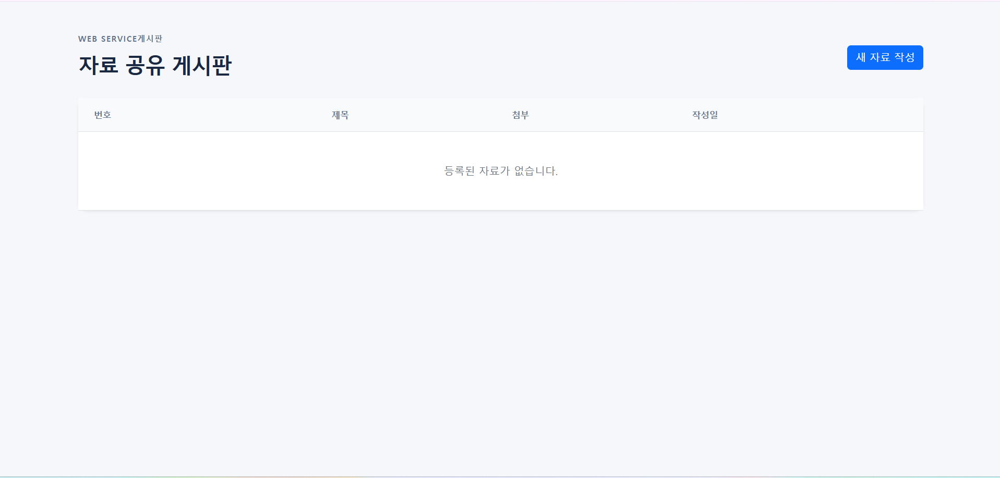
    
Style:

    app.css수정
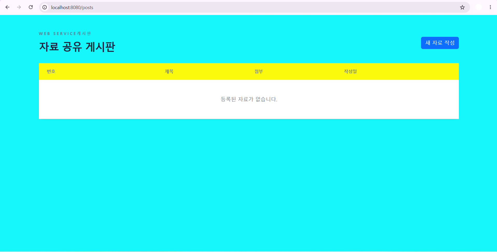

UI/Data:
    
    detail.html수정
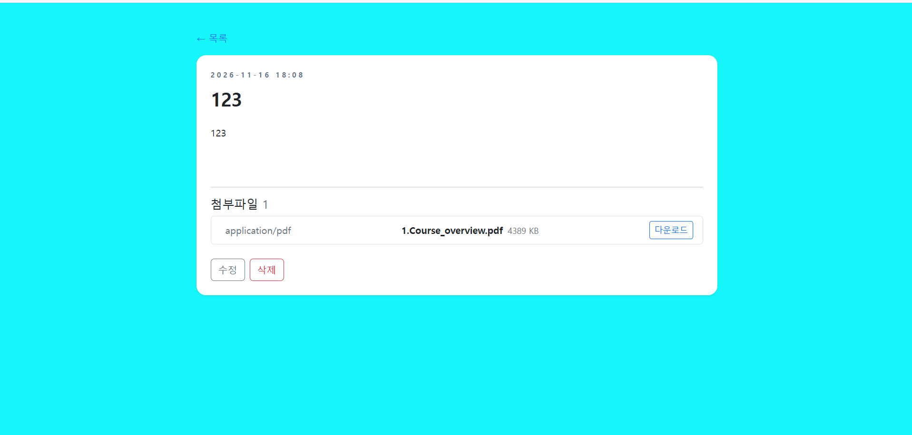

5.New Feature

    미리보기는 컨트롤러에 view 메서드를 만들고 detail.html에서 이미지면 미리보기가 보이게 만들었습니다.
    미리보기는 다운로드와 다르게 파일의 정보를 받았을때 이미지면 화면에 바로 띄워 주게 전달후 화면에서는 이미지 파일만
    화면에 바로 보이게 했습니다.

6.Testing & Deployment

Local Testing

    01_sample.png — Sample Project 초기 실행 화면 (Customizing 이전)

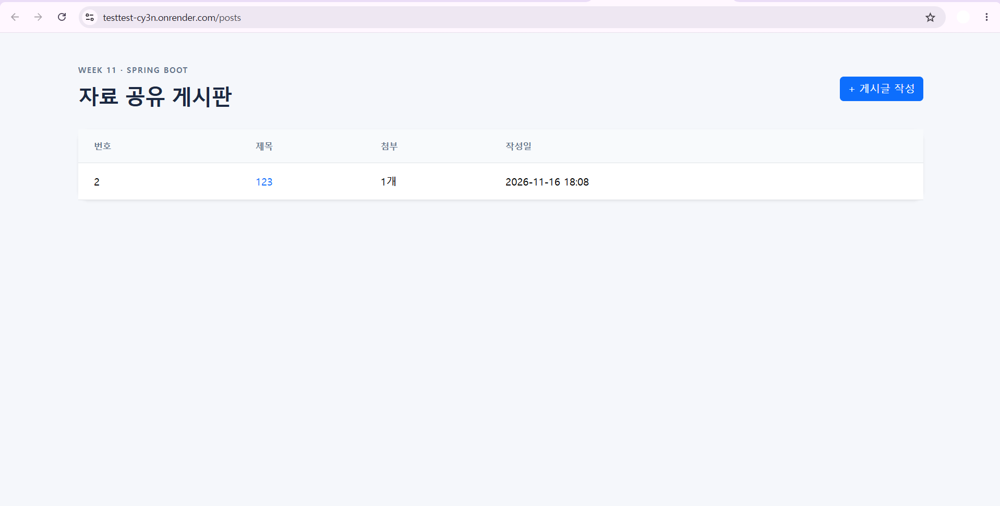

    02_upload.png — 파일 업로드 성공 화면
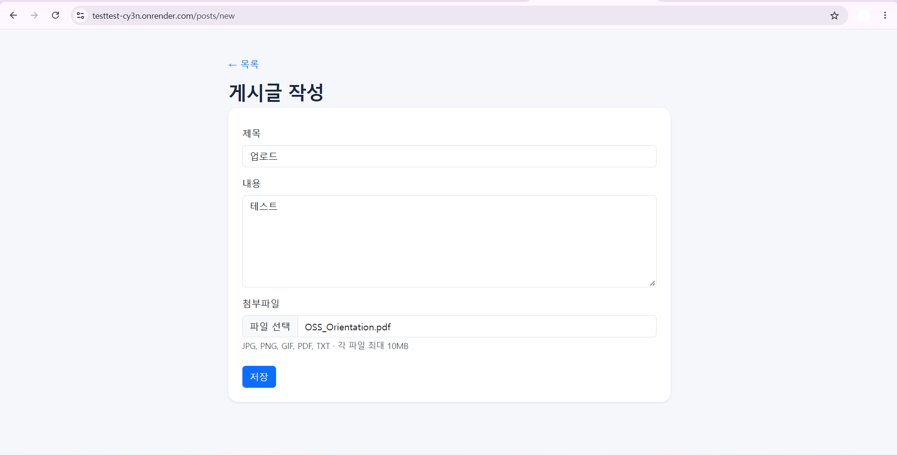
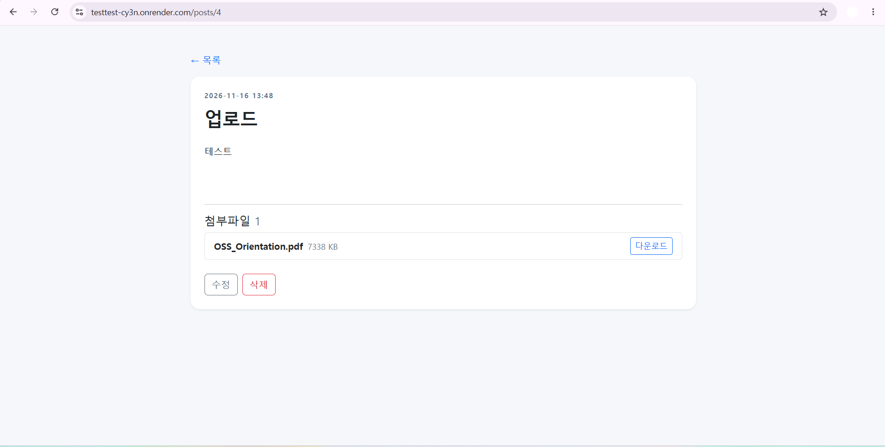

    03_download.png — 파일 다운로드 성공 화면

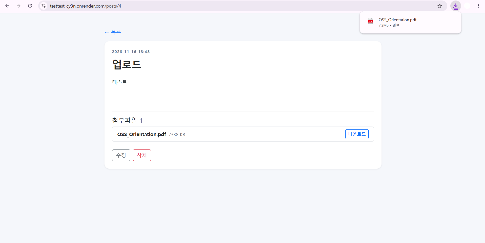

    04_preview.png — 이미지 미리보기 실행 화면

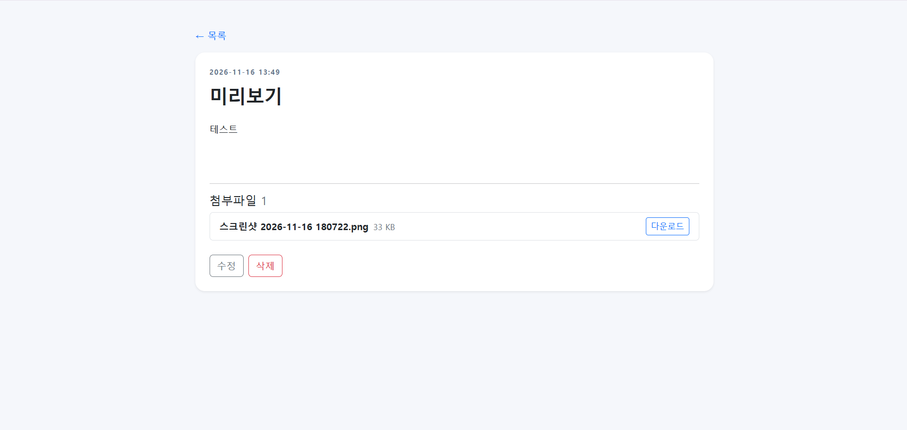

    기존 게시글 CRUD 및 오류 처리도 테스트

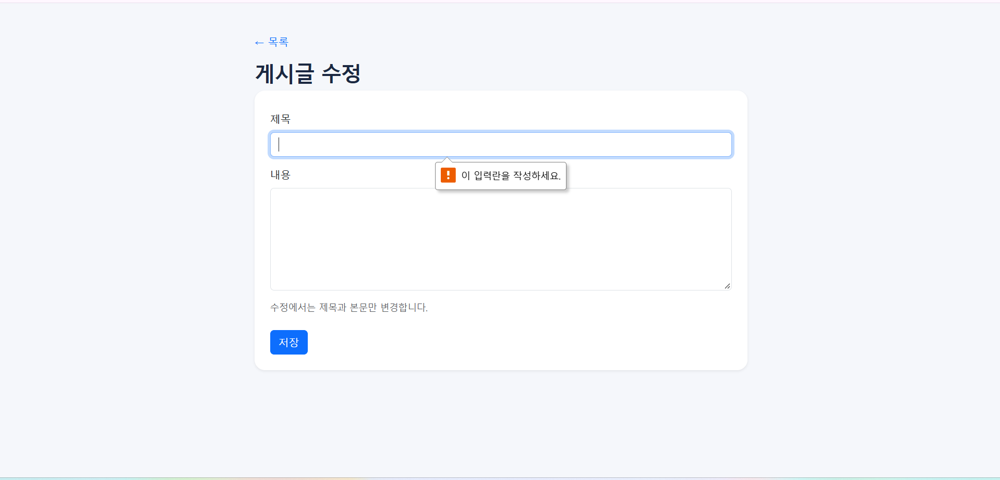

수정후 사진

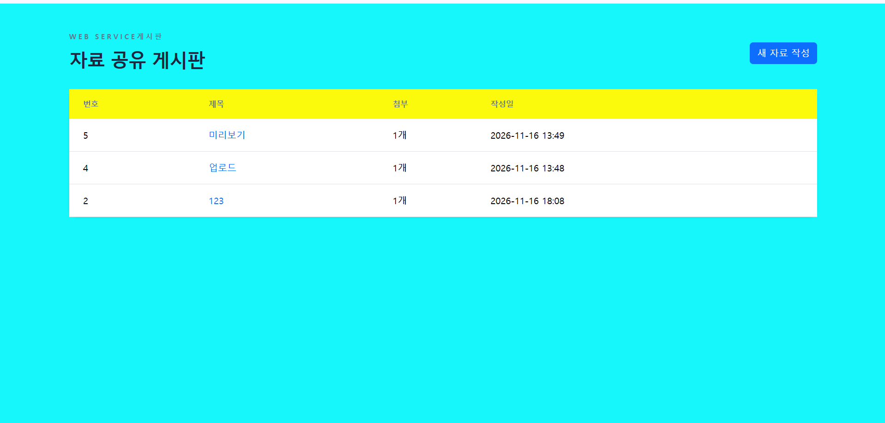

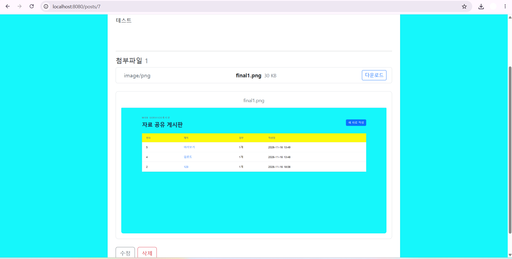

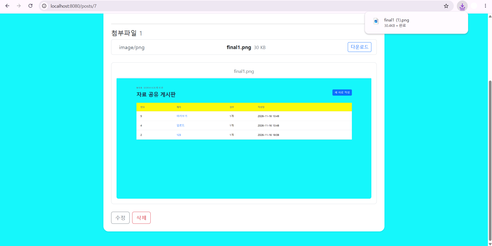

7.Weekly Review

새로배운내용

    파일과 파일 정보를 따로 저장하는 이유: 진짜 파일은 컴퓨터 폴더에 랜덤 이름으로 저장하고, 
    파일 원래 이름이나 크기 같은 정보만 DB에 따로 저장해야 파일 이름이 겹치지도 않고 관리하기 편하다는 걸 배웠습니다.

    다운로드와 미리보기의 차이: 똑같이 서버에서 파일을 보내줘도 헤더 설정을 다운로드용으로 주면 파일이 다운받아지고,
    이미지 타입으로 주면 화면에 바로 사진으로 뜬다는 걸 알게 되었습니다. 

    DB 삭제와 실제 파일 삭제의 차이: JPA 설정으로 게시글을 지우면 DB에 있는 파일 기록은 같이 지워지지만,
    컴퓨터 폴더에 있는 진짜 파일은 안 지워져서 코드로 직접 지워줘야 한다는 걸 배웠습니다.

어려웠던 점과 해결 방법

    어려웠던 점: 게시글에 사진이랑 일반 파일이 같이 올라갔을 때, 
    어떻게 해야 사진만 골라서 미리보기를 띄울 수 있을지 헷갈렸습니다.
    
    해결 방법: DB에 저장된 파일 타입이 사진 파일은 다 image/로 시작한다는 걸 확인하고,
    detail.html에서 th:if 조건문으로 image/로 시작할 때만  태그가 나오도록 만들어서 해결했습니다.

AI 활용 내용 및 느낀 점

    이번에는 전체적으로 PDF를 훝어보고 다시 공부하기위해 요약하기위해 ai를 사용했습니다.
    제가 공부한 내용과 코드를 이런식으로 사용하는게 맞는지 공부하기위해 사용했습니다.

웹사이트에서 파일이나 사진 미리보기 같은것도 생각보다 복잡하게 작동하는것 같아서 신기했습니다.
그래도 이제 이런 기능들을 구현 해볼수있을것 같아 보람이 느껴졌습니다.

